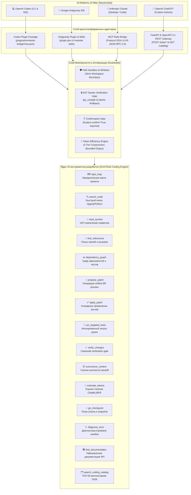

# 🚀 OmniTools Universal AI Coding Hub

<div align="center">

[](https://python.org)
[](https://fastapi.tiangolo.com)
[](https://modelcontextprotocol.io)
[](https://openai.com)
[](plugin.json)
[](https://github.com/Bexruz-cell/universal-ai-tools-hub/actions/workflows/ci.yml)
[](catalog/top_50_coding_repositories_2026.md)
[](LICENSE)

**Инструменты разработки через MCP для совместимых клиентов. Подключение и доступ к workspace настраиваются в каждом клиенте отдельно.**

### Пакет 2.1.1

Исправлен MCP stdio transport для синхронных coding tools; пакетные копии
Git checkpoints и анализа зависимостей синхронизированы с основным кодом.
CI проверяет все 15 coding tools через subprocess MCP как из основного дерева,
так и из изолированной копии пакета, включая запись в synthetic workspace,
Git checkpoint, EOF и запреты внешних путей. Матрица: Windows/Linux, Python 3.10–3.13.
Версия опубликованного private plugin — 2.1.1; установка обновления и разрешённые
корни workspace определяются клиентом. CI не подтверждает установку в клиенте.

[English Overview](#-english-overview) · [Архитектура](#-архитектура-экосистемы) · [15 Инструментов Разработки](#-каталог-15-инструментов-разработки) · [Оптимизация Токенов](#-оптимизация-контекста-и-экономия-токенов) · [Модель Безопасности](#-строгая-модель-безопасности-и-ast-песочница) · [Установка](#-быстрый-старт-и-подключение) · [ТОП-50 Каталог](catalog/top_50_coding_repositories_2026.md)

</div>

---

## 🌟 Ключевая концепция (Quad-Target Compatibility)

Большинство плагинов пишутся только под одну AI-платформу. **OmniTools Universal AI Coding Hub** решает эту проблему: единое защищённое ядро инструментов разработки одновременно работает с 4 ведущими средами разработки и агентными платформами:

| AI-среда / Клиент | Механизм интеграции | Протокол / Стандарт | Манифест конфигурации | Статус |
|:---|:---|:---|:---|:---:|
| **OpenAI Codex** | Codex Plugin Marketplace & CLI | Stdio MCP & Codex Skills | `.agents/plugins/marketplace.json`<br>`plugins/omnitools-bridge/` | ✅ **Verified & Installed** |
| **Google Antigravity** | Workspace & Global IDE Plugin | Native Customization & MCP | `plugin.json`<br>`skills/omnitools-bridge/` | ✅ **Production Ready** |
| **Anthropic Claude** | Claude Desktop & Claude Code | Model Context Protocol (stdio) | `configs/claude_desktop_config.json` | ✅ **Production Ready** |
| **ChatGPT Actions** | Custom GPT Actions (GPT-4o) | OpenAPI 3.1 REST API + CORS | `openapi.yaml`<br>`.well-known/ai-plugin.json` | ✅ **Production Ready** |

---

## 🏗️ Архитектура экосистемы



---

## 🛠️ Каталог 15 Инструментов Разработки

Все 15 инструментов реализованы в виде полноценных production-модулей без заглушек, с защитой от раздувания токенов и строгими границами безопасности:

| # | Инструмент | Модуль / MCP Tool | Назначение | Профиль эффективности |
|:---:|:---|:---|:---|:---|
| **1** | **`repo_map`** | `src.coding_tools.repo_map` | Иерархическая компактная карта структуры репозитория с разбивкой языков, размерами и ограничением глубины | Ограничение `max_entries` и `max_depth`, сжатие до 90% |
| **2** | **`search_code`** | `src.coding_tools.search` | Быстрый поиск по кодовой базе через ripgrep с фолбэком на Python regex и фильтрацией расширений | Обрезка строк `max_line_length` и лимит `max_results` |
| **3** | **`read_symbol`** | `src.coding_tools.symbols` | Извлечение сигнатуры, докстринга и тела функции/класса через AST без чтения файла целиком | Читает только нужный AST-узел вместо сотен строк файла |
| **4** | **`find_references`** | `src.coding_tools.symbols` | Сканирование всех вызовов, импортов и определений символа по всей кодовой базе | Группировка по файлам, защита контекста от раздувания |
| **5** | **`dependency_graph`** | `src.coding_tools.deps` | Построение прямого и обратного графа импортов модуля, внешних пакетов и списка затронутых тестов | Изолирует только зависимые модули и точечные тесты |
| **6** | **`propose_patch`** | `src.coding_tools.patcher` | Строго read-only генерация unified diff превью изменений с SHA-256 хешами до и после | Нулевое воздействие на файловую систему до подтверждения |
| **7** | **`apply_patch`** | `src.coding_tools.patcher` | Атомарное применение патча с обязательным `confirm=True`, бэкапом `.bak` и авто-откатом при ошибках | Автоматический откат при нарушении AST-синтаксиса |
| **8** | **`run_targeted_tests`** | `src.coding_tools.test_runner` | Запуск точечных pytest-целей в изолированном процессе с таймаутом и компактным отчётом | Ограничение вывода до 32 КБ, предотвращение зависаний |
| **9** | **`verify_changes`** | `src.coding_tools.test_runner` | Сквозной verification gate: проверка синтаксиса `py_compile` + запуск релевантных тестов | Предотвращает коммит сломанного или невалидного кода |
| **10** | **`summarize_context`** | `src.context_optimizer.compressor` | 4-уровневый адаптивный компрессор кода и интерфейсов для меж-агентных передач (handoff) | Строгое соблюдение лимита `max_tokens` (до 85% экономии) |
| **11** | **`estimate_tokens`** | `src.context_optimizer.budget` | Быстрый расчёт токенов с поддержкой ChatML сообщений, многоязычного текста и tiktoken | Точный учёт бюджета контекста перед вызовом LLM |
| **12** | **`git_checkpoint`** | `src.coding_tools.checkpoints` | Создание мгновенных точек отката (ветки/теги/snapshot), инспекция диффов и безопасный rollback | Гарантия сохранности кодовой базы при любых правках |
| **13** | **`diagnose_error`** | `src.coding_tools.diagnostics` | Парсинг Python traceback, определение типа исключения, строки ошибки и рекомендация решения | Извлечение контекста сбоя и готовых рекомендаций |
| **14** | **`find_documentation`** | `src.coding_tools.docs` | Поиск сигнатур и официальной документации стандартной библиотеки Python и популярных фреймворков | Встроенная база + интроспекция без сетевых задержек |
| **15** | **`search_coding_catalog`** | `src.coding_tools.catalog` | Полнотекстовый поиск по курируемой базе 50 лучших репозиториев 2026 года по категориям A–E | Мгновенная выдача метаданных, ссылок и use-cases |

---

## ⚡ Оптимизация Контекста и Экономия Токенов (Phase 2)

В агентных системах передача полных файлов быстро истощает контекстное окно модели. OmniTools внедряет многоуровневый слой **Token Efficiency**:

1. **Символьное извлечение вместо дампа файлов:**  
   Инструмент `read_symbol` читает конкретный AST-узел (например, 25 строк метода) вместо чтения файла на 1,500 строк, снижая расход токенов на **80–95%**.
2. **Адаптивное сжатие (4-Tier Compression):**  
   Инструмент `summarize_context` динамически масштабирует уровень детализации (полные сигнатуры ➔ краткие заглушки ➔ список символов), чтобы гарантированно уложиться в заданный бюджет `max_tokens`.
3. **Ограничение вывода терминала и тестов:**  
   Все раннеры тестов и поиска обрезают вывод (head + tail сохранение), исключая попадание бесконечных логов в промпт агента.
4. **Контроль бюджета перед генерацией:**  
   `estimate_tokens` позволяет агенту заранее проверить объём данных и принять решение о компрессии до отправки запроса.

---

## 🛡️ Строгая Модель Безопасности и AST-Песочница (Phase 4)

1. **Двухэтапная модификация (Propose ➔ Apply):**  
   Любое изменение сначала генерирует diff-превью через `propose_patch`. Применение через `apply_patch` требует явного флага подтверждения `confirm=True`.
2. **Песочница путей (Path Sandbox):**  
   Запрещены любые операции вне рабочей директории проекта. Исключены уязвимости обхода путей (`../`, абсолютные системные пути).
3. **Автоматический откат (Syntax Auto-Rollback):**  
   Если после применения патча файл содержит синтаксическую ошибку (`SyntaxError`), система автоматически восстанавливает исходную версию из страховочного бэкапа `.bak`.
4. **Мгновенные Git-чекпоинты:**  
   Перед рискованными операциями агент создаёт точку отката через `git_checkpoint(action="create")`, гарантируя возможность возврата в исходное рабочее состояние.
5. **SSRF Shield:**  
   Сохранён фильтр сетевой безопасности, блокирующий обращения к приватным диапазонам (RFC 1918, loopback, cloud metadata `169.254.169.254`, IPv6).

---

## 🗂️ ТОП-50 Курируемых Репозиториев 2026 (Phase 3)

В каталог `catalog/top_50_coding_repositories_2026.json` включены 50 активных, проверенных open-source проектов по 5 категориям:

- **Категория A — AI Coding Agents & IDE Assistants (10):**  
  OpenAI Codex, Claude Code, Aider, Continue, Cline, OpenCode, OpenHands, SWE-agent, Gemini CLI, Goose.
- **Категория B — Code Intelligence, Search & Parsing (10):**  
  Tree-sitter, ripgrep, ast-grep, Zoekt, Universal Ctags, Python LSP Server, Pyright, Jedi, Rope, VS Code Language Server.
- **Категория C — Multi-Agent Software Engineering (10):**  
  LangGraph, OpenAI Agents SDK, Microsoft Agent Framework, AutoGen, MetaGPT, CrewAI, ChatDev, CAMEL, AgentVerse, GPT Engineer.
- **Категория D — Testing, Code Quality & Security (10):**  
  pytest, Ruff, Semgrep, Bandit, Hypothesis, Mutmut, Coverage.py, Locust, Schemathesis, Gitleaks.
- **Категория E — Developer Automation & Token Efficiency (10):**  
  Repopack, Gitingest, tiktoken, LLM CLI, LiteLLM, Ollama, vLLM, Promptfoo, CopilotKit, OpenDevin.

---

## 🚀 Быстрый старт и подключение

### 1. Установка зависимостей
```bash
git clone https://github.com/Bexruz-cell/universal-ai-tools-hub.git
cd universal-ai-tools-hub
pip install -r requirements.txt
```

---

### А. Подключение к OpenAI Codex (CLI & Marketplace)

Репозиторий содержит проверенный манифест маркетплейса `.agents/plugins/marketplace.json` и переносимый пакет `plugins/omnitools-bridge/`.

1. **Регистрация локального маркетплейса:**
   ```bash
   codex plugin marketplace add .
   ```
2. **Установка плагина:**
   ```bash
   codex plugin add omnitools-bridge@universal-ai-tools-hub
   ```
3. **Проверка статуса:**
   ```bash
   codex plugin list
   # omnitools-bridge@universal-ai-tools-hub  installed, enabled  2.0.0
   ```

---

### Б. Подключение к Google Antigravity

Проект содержит манифест [`plugin.json`](plugin.json) и навыки в [`skills/`](skills/):
- Antigravity автоматически обнаруживает и регистрирует плагин при открытии воркспейса.
- Агенты Antigravity получают прямой доступ к MCP-серверу (`src/adapters/mcp_adapter.py`).

---

### В. Подключение к Anthropic Claude (Desktop & Code)

1. Откройте файл конфигурации Claude Desktop:
   - **Windows:** `%APPDATA%\Claude\claude_desktop_config.json`
   - **macOS:** `~/Library/Application Support/Claude/claude_desktop_config.json`
   - **Linux:** `~/.config/Claude/claude_desktop_config.json`
2. Добавьте сервер в блок `mcpServers`:
   ```json
   {
     "mcpServers": {
       "omnitools_coding_bridge": {
         "command": "python",
         "args": ["C:\\path\\to\\universal-ai-tools-hub\\src\\adapters\\mcp_adapter.py"],
         "env": {
           "PYTHONIOENCODING": "utf-8"
         }
       }
     }
   }
   ```
3. Перезапустите Claude — инструменты появятся в панели инструментов.

---

### Г. Подключение к OpenAI ChatGPT (Custom GPT Actions)

1. Запустите REST API сервер:
   ```bash
   python main.py --mode api --host 0.0.0.0 --port 8000
   ```
2. Создайте туннель:
   ```bash
   cloudflared tunnel --url http://localhost:8000
   # или: ngrok http 8000
   ```
3. В интерфейсе **ChatGPT** -> **Create GPT** -> **Create new action** импортируйте спецификацию [`openapi.yaml`](openapi.yaml) (или `openapi.json`).

---

## 🧪 Тестирование и верификация

Все компоненты покрыты сквозным набором тестов:
```bash
pytest tests/ -v
```

**Результат верификации:**  
- **Общий статус:** `189 passed, 1 skipped (100% Green)` ✅
- **Набор coding-инструментов:** `tests/test_coding_tools.py` — `46/46 passed` ✅
- **Патчер и безопасность:** `tests/test_patcher.py`, `tests/test_security.py` — `passed` ✅
- **Оптимизация контекста:** `tests/test_compressor.py` — `passed` ✅
- **Раннер тестов и гейты:** `tests/test_test_runner.py` — `passed` ✅
- **Адаптеры Codex, Claude, Antigravity:** `tests/test_compatibility.py`, `tests/test_mcp.py` — `passed` ✅

---

## 📂 Структура проекта

```
universal-ai-tools-hub/
├── .agents/plugins/
│   └── marketplace.json         # Манифест OpenAI Codex Plugin Marketplace
├── .github/workflows/
│   └── ci.yml                   # Кроссплатформенный CI (Ubuntu, Windows / Python 3.10-3.13)
├── .well-known/
│   └── ai-plugin.json           # Манифест ChatGPT Plugins
├── catalog/
│   ├── top_50_coding_repositories_2026.json # База ТОП-50 coding-репозиториев
│   └── top_50_coding_repositories_2026.md
├── configs/
│   └── claude_desktop_config.json # Готовый конфиг для Claude Desktop
├── plugins/omnitools-bridge/    # Автономный переносимый пакет для Codex
│   ├── run_mcp.py               # Автономный раннер в кэше
│   └── skills/                  # Специализированные навыки
├── src/
│   ├── adapters/
│   │   ├── api_adapter.py       # FastAPI REST & OpenAPI 3.1 адаптер
│   │   └── mcp_adapter.py       # MCP Stdio JSON-RPC 2.0 адаптер
│   ├── coding_tools/            # Ядро 15 инструментов разработки
│   │   ├── catalog.py           # search_coding_catalog
│   │   ├── checkpoints.py       # git_checkpoint
│   │   ├── deps.py              # dependency_graph
│   │   ├── diagnostics.py       # diagnose_error
│   │   ├── docs.py              # find_documentation
│   │   ├── patcher.py           # propose_patch, apply_patch
│   │   ├── repo_map.py          # repo_map
│   │   ├── search.py            # search_code
│   │   ├── symbols.py           # read_symbol, find_references
│   │   └── test_runner.py       # run_targeted_tests, verify_changes
│   ├── context_optimizer/       # Слой оптимизации контекста
│   │   ├── budget.py            # estimate_tokens
│   │   ├── compressor.py        # summarize_context
│   │   └── indexer.py           # Индексация символов
│   └── security/                # Защитные барьеры и песочницы
├── tests/                       # 189+ сквозных тестов
│   ├── test_coding_tools.py     # Интеграционный сьют всех 15 инструментов
│   ├── test_patcher.py
│   ├── test_compressor.py
│   ├── test_test_runner.py
│   ├── test_security.py
│   ├── test_codex_install.py
│   ├── test_compatibility.py
│   ├── test_mcp.py
│   └── test_api.py
├── openapi.yaml                 # Спецификация OpenAPI 3.1
├── plugin.json                  # Манифест Google Antigravity
├── requirements.txt             # Зависимости
├── main.py                      # CLI-запуск (--mode api / mcp / test)
└── README.md                    # Главная документация проекта
```

---

## 📄 Лицензия
Распространяется под свободной лицензией MIT.  
**Автор:** Bexruz stark ([@Bexruz-cell](https://github.com/Bexruz-cell))
