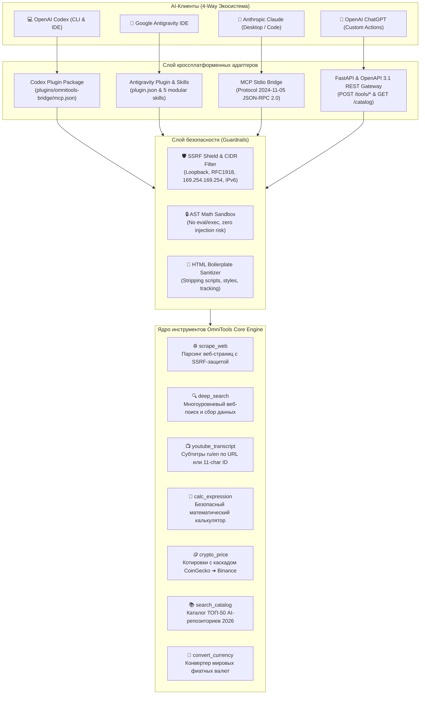

# 🌐 OmniTools Universal AI Bridge

<div align="center">

[](https://python.org)
[](https://fastapi.tiangolo.com)
[](https://modelcontextprotocol.io)
[](https://openai.com)
[-success.svg)](https://pytest.org)
[](LICENSE)

**Единый универсальный мост инструментов (Quad-Target Compatibility), сертифицированный для OpenAI Codex, Google Antigravity, Anthropic Claude и ChatGPT Actions.**

[English Overview](#-english-overview) · [Архитектура](#-архитектура-экосистемы) · [Установка](#-быстрый-старт-и-подключение) · [Инструменты](#-каталог-инструментов) · [Безопасность (SSRF)](#-модель-безопасности-и-ssrf-защита) · [ТОП-50 Каталог 2026](catalog/top_50_repositories_2026.md)

</div>

---

## 🌟 Ключевая концепция (Quad-Target Compatibility)

Большинство плагинов пишутся только под одну AI-платформу. **OmniTools Universal Bridge** решает эту проблему: единое защищённое ядро инструментов одновременно работает с 4 ведущими средами разработки и агентными платформами:

| AI-среда / Клиент | Механизм интеграции | Протокол / Стандарт | Манифест конфигурации | Статус |
|:---|:---|:---|:---|:---:|
| **OpenAI Codex** | Codex Plugin Marketplace & CLI | Stdio MCP & Codex Skills | `.agents/plugins/marketplace.json`<br>`plugins/omnitools-bridge/` | ✅ **Verified & Installed** |
| **Google Antigravity** | Workspace & Global IDE Plugin | Native Customization & MCP | `plugin.json`<br>`skills/omnitools-bridge/` | ✅ **Production Ready** |
| **Anthropic Claude** | Claude Desktop & Claude Code | Model Context Protocol (stdio) | `configs/claude_desktop_config.json` | ✅ **Production Ready** |
| **ChatGPT Actions** | Custom GPT Actions (GPT-4o) | OpenAPI 3.1 REST API + CORS | `openapi.yaml`<br>`.well-known/ai-plugin.json` | ✅ **Production Ready** |

---

## 🏗️ Архитектура экосистемы



---

## 🚀 Быстрый старт и подключение

### 1. Установка зависимостей
```bash
git clone https://github.com/Bexruz-cell/universal-ai-tools-hub.git
cd universal-ai-tools-hub
pip install -r requirements.txt
```

---

### А. Подключение к OpenAI Codex (CLI & Marketplace)

Репозиторий содержит сертифицированный манифест `.agents/plugins/marketplace.json` и портативный пакет `plugins/omnitools-bridge/`.

1. **Регистрация локального маркетплейса в Codex:**
   ```bash
   codex plugin marketplace add .
   ```
2. **Установка плагина:**
   ```bash
   codex plugin add omnitools-bridge@universal-ai-tools-hub
   ```
3. **Проверка статуса:**
   ```bash
   codex plugin list
   # omnitools-bridge@universal-ai-tools-hub  installed, enabled  1.0.0
   ```

Плагин полностью автономен: при установке в кэш (`~/.codex/plugins/cache/`) он запускается через `run_mcp.py` без зависимости от исходной папки.

---

### Б. Подключение к Google Antigravity

Проект уже содержит корневой манифест [`plugin.json`](plugin.json) и навыки в [`plugins/omnitools-bridge/skills/`](plugins/omnitools-bridge/skills/):
- Antigravity автоматически обнаруживает и активирует плагин при открытии папки воркспейса.
- Агенты Antigravity получают доступ к инструментам через MCP-сервер (`src/adapters/mcp_adapter.py`).

---

### В. Подключение к Anthropic Claude (Desktop & Code)

1. Откройте конфигурационный файл Claude Desktop:
   - **Windows:** `%APPDATA%\Claude\claude_desktop_config.json`
   - **macOS:** `~/Library/Application Support/Claude/claude_desktop_config.json`
   - **Linux:** `~/.config/Claude/claude_desktop_config.json`
2. Добавьте блок сервера:
   ```json
   {
     "mcpServers": {
       "omnitools_bridge": {
         "command": "python",
         "args": ["C:\\path\\to\\universal-ai-tools-hub\\src\\adapters\\mcp_adapter.py"],
         "env": {
           "PYTHONIOENCODING": "utf-8"
         }
       }
     }
   }
   ```
3. Перезапустите Claude — все 7 инструментов появятся в меню доступных инструментов.

---

### Г. Подключение к OpenAI ChatGPT (Custom GPT Actions)

1. Запустите REST API сервер:
   ```bash
   python main.py --mode api --host 0.0.0.0 --port 8000
   ```
2. Поднимите публичный туннель:
   ```bash
   cloudflared tunnel --url http://localhost:8000
   # или: ngrok http 8000
   ```
3. В интерфейсе **ChatGPT** -> **Create GPT** -> **Create new action** вставьте спецификацию [`openapi.yaml`](openapi.yaml) (или `openapi.json`).
4. Подробная инструкция: [docs/chatgpt_setup_guide.md](docs/chatgpt_setup_guide.md).

---

## 🛠️ Каталог инструментов

| Инструмент | MCP Tool Name | REST Endpoint | Описание |
|:---|:---|:---|:---|
| **Веб-скрейпер** | `scrape_web` | `POST /tools/scrape` | Извлечение чистого Markdown с защитой от SSRF и приватных IP |
| **Глубокий поиск** | `deep_search` | `POST /tools/search` | Многоуровневый веб-поиск с форматированием сниппетов |
| **YouTube транскрипты** | `youtube_transcript` | `POST /tools/youtube` | Полные субтитры (ru/en) по ссылке или 11-значному video ID |
| **Безопасный калькулятор**| `calc_expression` | `POST /tools/calc` | Вычисление формул через AST-песочницу (без eval/exec) |
| **Крипто-котировки** | `crypto_price` | `POST /tools/crypto` | Спотовые цены и 24ч изменение (каскад CoinGecko ➔ Binance) |
| **Каталог ТОП-50 2026** | `search_catalog` | `GET /catalog` | Полнотекстовый поиск по 50 лучшим open-source AI-инструментам |
| **Конвертер валют** | `convert_currency` | `GET /api/v1/finance/convert` | Конвертация мировых фиатных валют по курсам центробанков |

---

## 🛡️ Модель безопасности и SSRF-защита

Функция веб-скрейпинга защищена модулем **SSRF Defense Engine**:
- **Блокировка приватных и локальных сетей:** Запрещены обращения к `127.0.0.0/8`, `10.0.0.0/8`, `172.16.0.0/12`, `192.168.0.0/16`, `0.0.0.0/8`, `100.64.0.0/10`.
- **Защита от утечки облачных метаданных:** Заблокирован адрес `169.254.169.254` (AWS, GCP, Azure metadata).
- **Поддержка IPv6:** Блокировка `::1`, `fe80::/10`, `fc00::/7`, а также IPv4-mapped IPv6 адресов (`::ffff:127.0.0.1`).
- **Pre-check DNS резолвинга:** Каждый домен резолвится через `socket.getaddrinfo`, и проверяется каждый полученный IP-адрес.
- **Безопасная обработка редиректов:** Каждый редирект (301, 302, 307, 308) проверяется повторно, исключая SSRF через редиректы.
- **AST Sandbox:** Калькулятор математических выражений валидирует узлы AST и запрещает вызовы произвольных функций, импорты и доступ к системным атрибутам.

---

## 🧪 Тестирование и верификация

Все компоненты покрыты сквозными тестами:
```bash
pytest tests/ -v
```
**Результат:** `79 passed in 15s (100% Green)` ✅

---

## 📂 Структура проекта

```
universal-ai-tools-hub/
├── .agents/plugins/
│   └── marketplace.json         # Манифест Codex Plugin Marketplace
├── .github/workflows/
│   └── ci.yml                   # Кроссплатформенный CI (Ubuntu, Windows / Python 3.10-3.13)
├── .well-known/
│   └── ai-plugin.json           # Манифест ChatGPT Plugins
├── catalog/
│   ├── catalog_2026.json        # База ТОП-50 репозиториев 2026
│   └── top_50_repositories_2026.md
├── configs/
│   └── claude_desktop_config.json # Готовый конфиг для Claude Desktop
├── plugins/omnitools-bridge/    # Автономный пакет плагина для Codex
│   ├── .codex-plugin/plugin.json
│   ├── .mcp.json
│   ├── mcp.json
│   ├── plugin.json
│   ├── run_mcp.py               # Автономный переносимый раннер
│   └── skills/                  # 5 специализированных навыков
│       ├── calc-expression/
│       ├── crypto-price/
│       ├── deep-search/
│       ├── scrape-web/
│       └── youtube-transcript/
├── src/
│   ├── adapters/
│   │   ├── api_adapter.py       # FastAPI REST & OpenAPI адаптер
│   │   └── mcp_adapter.py       # MCP Stdio JSON-RPC 2.0 адаптер
│   └── core/
│       └── tools.py             # 7 инструментов + SSRF Shield + AST Sandbox
├── tests/                       # 79 сквозных тестов
│   ├── test_api.py
│   ├── test_codex_install.py
│   ├── test_compatibility.py
│   ├── test_mcp.py
│   ├── test_server.py
│   ├── test_ssrf.py
│   └── test_tools.py
├── openapi.yaml                 # Спецификация OpenAPI 3.1
├── openapi.json
├── plugin.json                  # Манифест Google Antigravity
├── requirements.txt             # Корневые зависимости
├── main.py                      # Единый CLI-запуск (--mode api / mcp / test)
└── README.md                    # Главная документация
```

---

## 📄 Лицензия
Распространяется под свободной лицензией MIT.  
**Автор:** Bexruz stark ([@Bexruz-cell](https://github.com/Bexruz-cell))
