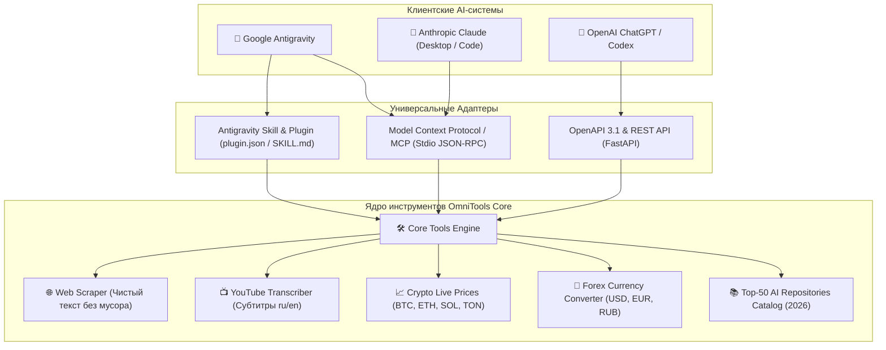

# 🌐 OmniTools Universal AI Bridge

<div align="center">

[](https://python.org)
[](https://fastapi.tiangolo.com)
[](https://modelcontextprotocol.io)
[-success.svg)](https://pytest.org)
[](LICENSE)

**Единый универсальный мост инструментов, совместимый с Google Antigravity, Anthropic Claude и OpenAI ChatGPT / Codex.**

[English Documentation](#-english-overview) · [Архитектура](#-архитектура-экосистемы) · [Каталог ТОП-50 2026](catalog/top_50_repositories_2026.md) · [Быстрый старт](#-быстрый-старт)

</div>

---

## 🌟 Ключевая концепция (Triple-Target Compatibility)

Большинство плагинов пишутся только под одну нейросеть. **OmniTools** решает эту проблему: единое ядро инструментов сразу работает с тремя главными платформами:



---

## 🛠 Встроенные возможности

1. **🌐 Web Scraper (`scrape_web` / `/api/v1/web/scrape`)**:  
   Превращает любой URL в чистый Markdown/текст для анализа LLM, вычищая рекламу, скрипты, навигацию и стили.
2. **📺 YouTube Transcriber (`get_youtube_transcript` / `/api/v1/youtube/transcript`)**:  
   Мгновенное извлечение полных субтитров и транскриптов видео по ссылке или ID (поддержка `ru`, `en` и автосубтитров).
3. **📈 Crypto Live Tickers (`get_crypto_prices` / `/api/v1/crypto/price`)**:  
   Реальные цены, капитализация и 24ч динамика для топ-криптовалют без необходимости в API-ключах.
4. **💱 Валютный конвертер (`convert_currency` / `/api/v1/finance/convert`)**:  
   Точные курсы мировых фиатных валют (USD, EUR, RUB, CNY, KZT).
5. **📚 Каталог ТОП-50 репозиториев 2026 (`search_catalog` / `/api/v1/catalog`)**:  
   Программный поиск по актуальной базе из 50 лучших open-source инструментов для расширения возможностей AI.

---

## 🚀 Быстрый старт и подключение

### 1. Установка зависимостей
```bash
git clone https://github.com/Bexruz-cell/universal-ai-tools-hub.git
cd universal-ai-tools-hub
pip install -r server/requirements.txt
```

---

### А. Подключение к Google Antigravity
Проект уже содержит манифест [`plugin.json`](plugin.json) и навык [`skills/omnitools-bridge/SKILL.md`](skills/omnitools-bridge/SKILL.md).
* Antigravity автоматически обнаруживает навык в директории `skills/` или подключает MCP-сервер из `src/adapters/mcp_adapter.py`.

---

### Б. Подключение к Anthropic Claude (Desktop / Code)
MCP-сервер работает по стандартному протоколу Model Context Protocol.

1. Откройте файл конфигурации Claude Desktop:  
   `%APPDATA%\Claude\claude_desktop_config.json` (Windows) или `~/Library/Application Support/Claude/claude_desktop_config.json` (macOS).
2. Добавьте блок из [`configs/claude_desktop_config.json`](configs/claude_desktop_config.json):
```json
{
  "mcpServers": {
    "omnitools-hub": {
      "command": "python",
      "args": ["C:\\path\\to\\universal-ai-tools-hub\\src\\adapters\\mcp_adapter.py"],
      "env": {
        "PYTHONIOENCODING": "utf-8"
      }
    }
  }
}
```
3. Перезапустите Claude — в панели появится значок молотка 🔨 со всеми инструментами!

---

### В. Подключение к OpenAI ChatGPT / Codex
1. Запустите API-сервер:
   ```bash
   python main.py --mode api
   ```
2. Откройте туннель наружу для тестов (`cloudflared tunnel --url http://localhost:8000` или `ngrok http 8000`).
3. В интерфейсе **ChatGPT (Custom GPT)** -> **Create new action** -> вставьте схему из [`openapi.yaml`](openapi.yaml).
4. Подробная инструкция: [docs/chatgpt_setup_guide.md](docs/chatgpt_setup_guide.md).

---

## 🧪 Тестирование и верификация

Все компоненты (API, MCP и ядро) покрыты сквозными тестами:
```bash
python main.py --mode test
```
**Результат:** `7 passed (100% Green)` ✅

---

## 📂 Структура проекта

```
universal-ai-tools-hub/
├── 📁 catalog/                  # Каталог ТОП-50 репозиториев (MD + JSON)
│   ├── top_50_repositories_2026.md
│   └── catalog_2026.json
├── 📁 src/                      # Исходный код ядра и адаптеров
│   ├── 📁 core/                 # Чистая логика инструментов (tools.py)
│   └── 📁 adapters/             # Адаптеры платформ
│       ├── mcp_adapter.py       # MCP-сервер для Claude & Antigravity
│       └── api_adapter.py       # FastAPI REST/OpenAPI для ChatGPT & Codex
├── 📁 skills/                   # Нативные навыки Antigravity
│   └── 📁 omnitools-bridge/     # SKILL.md
├── 📁 configs/                  # Готовые конфиги для Claude Desktop
├── 📁 docs/                     # Руководства по установке
├── 📁 tests/                    # Набор тестов (pytest)
├── .well-known/ai-plugin.json   # Манифест ChatGPT Plugins
├── openapi.yaml                 # Готовая спецификация OpenAPI 3.1
├── plugin.json                  # Манифест Antigravity Plugin
├── main.py                      # Универсальный CLI-запуск
└── README.md                    # Главная документация
```

---

## 📄 Лицензия
Распространяется под свободной лицензией MIT. Создано для сообщества AI-разработчиков.  
**Автор:** Bexruz stark ([@Bexruz-cell](https://github.com/Bexruz-cell))
