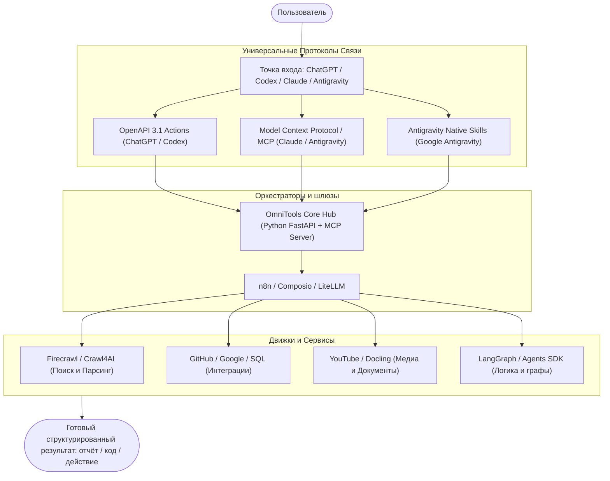

# 🚀 ТОП-50 GitHub-репозиториев для расширения возможностей ChatGPT, Claude и Antigravity (2026)

**Актуальность:** 12 октября 2026 года · 5 категорий · 50 репозиториев  
Подборка охватывает разработку собственных инструментов для ChatGPT / Codex, Claude Desktop, Antigravity, интеграцию с API, подключение Google и Telegram, веб-поиск, AI-агентов и локальную автоматизацию.

> [!IMPORTANT]
> **Важное изменение в архитектуре AI-экосистем 2026 года:**  
> OpenAI готовит эволюцию Custom GPTs и рекомендует переходить на расширенную систему Plugins / Function Calling / MCP. Для затронутых Enterprise-пространств прекращение поддержки запланировано на 11 декабря 2026 года; для других тарифов ожидается аналогичный график. Поэтому универсальный мост должен одновременно поддерживать **OpenAPI 3.1 Actions (для ChatGPT)**, **Model Context Protocol / MCP (для Claude и Antigravity)** и **Skills API**.

---

## 🏆 Топ-7 проектов первой необходимости

| Проект | Основное применение | Уровень сложности |
| :--- | :--- | :--- |
| **n8n** | Автоматизация сервисов, очередей и AI | Низкий–средний |
| **Firecrawl** | Быстрый и чистый сбор информации из интернета для LLM | Низкий–средний |
| **OpenAI Agents SDK** | Построение собственных production AI-агентов | Средний |
| **GitHub MCP Server** | Подключение GitHub репозиториев и PR к AI | Средний |
| **Composio** | Единая авторизация и подключение 100+ внешних сервисов | Средний |
| **LangGraph** | Управление сложными агентными графами с сохранением состояния | Высокий |
| **LiteLLM** | Единый AI-шлюз для переключения между OpenAI, Claude, Gemini | Средний |

---

## 1. Готовые шаблоны Custom Actions и OpenAPI (Репозитории 1–10)
*Подготовка API, схем, Actions и проверка совместимости*

1. [OpenAI Cookbook](https://github.com/openai/openai-cookbook) — официальная библиотека примеров использования OpenAI API, включая GPT Actions. *Польза:* можно взять готовые схемы для Google Calendar, GitHub и других сервисов, адаптировать авторизацию и подключить их к Custom GPT.
2. [GPT Actions Orchestrator](https://github.com/hmlendea/gpt-actions-orchestrator) — HTTP-сервис на .NET, маршрутизирующий вызовы GPT Actions к внешним API. *Польза:* позволяет организовать несколько интеграций за одним серверным endpoint вместо написания отдельного backend для каждого действия.
3. [APIs.guru OpenAPI Directory](https://github.com/APIs-guru/openapi-directory) — регулярно обновляемая коллекция OpenAPI-описаний публичных веб-сервисов. *Польза:* находить готовые API-спецификации и адаптировать нужные методы под Actions или собственные инструменты ChatGPT.
4. [Microsoft Power Platform Connectors](https://github.com/microsoft/PowerPlatformConnectors) — большая библиотека шаблонов и спецификаций коннекторов для Microsoft Power Platform. *Польза:* использовать существующие описания HTTP-операций как основу для интеграций ChatGPT, предварительно адаптировав формат и OAuth.
5. [OpenAI OpenAPI](https://github.com/openai/openai-openapi) — официальная машиночитаемая спецификация OpenAI REST API в формате OpenAPI 3.1. *Польза:* генерировать клиентов, изучать структуру запросов и строить собственный совместимый API-шлюз.
6. [Swagger Editor](https://github.com/swagger-api/swagger-editor) — визуальный редактор спецификаций OpenAPI. *Польза:* писать, исправлять и проверять YAML/JSON-схемы до подключения к GPT Actions.
7. [Redocly CLI](https://github.com/Redocly/redocly-cli) — инструмент проверки, объединения, тестирования и документирования OpenAPI. *Польза:* автоматически проверять схемы Actions, устранять ошибки контрактов и объединять спецификации в один файл.
8. [Stoplight Spectral](https://github.com/stoplightio/spectral) — линтер для JSON, YAML и OpenAPI с настраиваемыми правилами. *Польза:* встроить в CI проверку корректности схем, описаний параметров и требований к авторизации.
9. [OpenAPI Generator](https://github.com/OpenAPITools/openapi-generator) — генератор программных клиентов, серверных заготовок и документации по OpenAPI. *Польза:* быстро создавать backend и API-клиенты для интеграции с ChatGPT.
10. [Scalar](https://github.com/scalar/scalar) — платформа для документации API и выполнения HTTP-запросов. *Польза:* визуально тестировать endpoints и проверять реальные ответы перед предоставлением инструментов AI-агенту.

---

## 2. Парсинг, поиск и извлечение данных (Репозитории 11–20)
*Веб-поиск, браузер, HTML, PDF и подготовка данных для RAG*

11. [Firecrawl](https://github.com/firecrawl/firecrawl) — извлекает содержимое веб-страниц и сайтов в удобных для LLM форматах, включая Markdown. *Польза:* создать для ChatGPT инструмент чтения сайтов, сбора документации и исследования конкурентов через API.
12. [Crawl4AI](https://github.com/unclecode/crawl4ai) — открытый веб-краулер, подготавливающий контент сайтов для языковых моделей. *Польза:* собирать актуальные данные локально или на сервере для собственного поискового агента.
13. [ScrapeGraphAI](https://github.com/ScrapeGraphAI/Scrapegraph-ai) — Python-фреймворк для извлечения структурированных данных с сайтов при помощи LLM. *Польза:* получать конкретные поля (цены, названия, характеристики) вместо полного HTML.
14. [Crawlee](https://github.com/apify/crawlee) — библиотека создания надёжных веб-краулеров на JavaScript и TypeScript. *Польза:* организовать регулярный сбор информации и передавать результат в ChatGPT через API.
15. [Scrapy](https://github.com/scrapy/scrapy) — производительный Python-фреймворк для веб-скрейпинга. *Польза:* создание собственной масштабной системы сбора информации.
16. [Playwright](https://github.com/microsoft/playwright) — управление Chromium, Firefox и WebKit для тестирования и автоматизации браузеров. *Польза:* серверный агент может открывать сложные SPA-сайты и проходить авторизацию.
17. [Docling](https://github.com/docling-project/docling) — конвертирует PDF и сложные документы в структуру, подходящую для AI-обработки. *Польза:* извлекать текст и таблицы из документов для RAG-поиска.
18. [Unstructured](https://github.com/Unstructured-IO/unstructured) — обработка неструктурированных документов и преобразование в элементы для AI-пайплайнов. *Польза:* загрузка документов в базы знаний с сохранением метаданных.
19. [SearXNG](https://github.com/searxng/searxng) — приватная метапоисковая система, объединяющая результаты разных поисковиков. *Польза:* собственный поисковый бэкенд без привязки к Google/Bing.
20. [Browser Use](https://github.com/browser-use/browser-use) — инструментарий для взаимодействия AI-агентов с веб-браузером. *Польза:* агент самостоятельно выполняет многошаговые действия на сайтах (заказ билетов, заполнение форм).

---

## 3. Интеграция с Google, Notion, Telegram, SQL и GitHub (Репозитории 21–30)
*Внешние приложения, базы данных, MCP и авторизация*

21. [Model Context Protocol Servers](https://github.com/modelcontextprotocol/servers) — официальный набор эталонных реализаций MCP-серверов от Anthropic. *Польза:* золотой стандарт для предоставления AI доступа к локальным файлам, Git, базам и контексту.
22. [GitHub MCP Server](https://github.com/github/github-mcp-server) — официальный MCP-сервер GitHub для работы с репозиториями, issues и PR. *Польза:* автоматизация аудита кода, создание коммитов и код-ревью.
23. [Google API Python Client](https://github.com/googleapis/google-api-python-client) — официальная библиотека для API Google. *Польза:* ChatGPT работает с Gmail, Google Calendar, Google Drive и Sheets.
24. [Google Workspace CLI](https://github.com/googleworkspace/cli) — единый CLI для Google Drive, Gmail, Calendar, Sheets, Docs. *Польза:* быстрый запуск операций Google из агентов с готовой OAuth-авторизацией.
25. [Notion SDK for JavaScript](https://github.com/makenotion/notion-sdk-js) — официальный JS/TS-клиент Notion API. *Польза:* поиск, чтение и ведение баз знаний Notion через Custom Action.
26. [aiogram](https://github.com/aiogram/aiogram) — асинхронный Python-фреймворк для Telegram Bot API. *Польза:* создание Telegram-интерфейсов для ChatGPT и автоматизация уведомлений.
27. [python-telegram-bot](https://github.com/python-telegram-bot/python-telegram-bot) — проверенная Python-библиотека для Telegram-ботов. *Польза:* отказоустойчивые боты с фоновыми задачами и очередями.
28. [DBHub](https://github.com/bytebase/dbhub) — универсальный MCP-сервер для PostgreSQL, MySQL, MariaDB, SQLite, SQL Server и Oracle. *Польза:* контролируемые SQL-запросы к корпоративным базам данных в режиме read-only.
29. [Supabase MCP](https://github.com/supabase/mcp) — инструмент для подключения AI-ассистентов к проектам Supabase. *Польза:* работа с векторными базами данных pgvector и таблицами Supabase.
30. [Composio](https://github.com/ComposioHQ/composio) — платформа интеграций и управления инструментами, авторизацией и контекстом для AI-агентов. *Польза:* подключение 200+ внешних сервисов (Jira, Salesforce, HubSpot) без написания кода интеграций.

---

## 4. AI-агенты и фреймворки (Репозитории 31–40)
*Многоагентные системы, orchestration, Python и TypeScript*

31. [LangChain](https://github.com/langchain-ai/langchain) — базовый фреймворк для создания приложений с LLM и внешними инструментами. *Польза:* объединение моделей, RAG и Action-вызовов в единую логическую цепочку.
32. [LangGraph](https://github.com/langchain-ai/langgraph) — фреймворк циклических графов с сохранением состояния. *Польза:* создание отказоустойчивых сценариев с ветвлениями и валидацией человеком (Human-in-the-loop).
33. [Microsoft Agent Framework](https://github.com/microsoft/agent-framework) — официальный преемник AutoGen от Microsoft. *Польза:* промышленная оркестрация совместной работы специализированных AI-агентов на Python и .NET.
34. [CrewAI](https://github.com/crewAIInc/crewAI) — фреймворк создания команд AI-агентов с ролевой моделью. *Польза:* распределение задач между исследователем, кодером, тестировщиком и факт-чекером.
35. [OpenAI Agents SDK (Python)](https://github.com/openai/openai-agents-python) — официальный SDK от OpenAI для создания агентов и многоагентных процессов. *Польза:* прямое использование стандартов OpenAI для оркестрации инструментов.
36. [OpenAI Agents SDK (JavaScript)](https://github.com/openai/openai-agents-js) — JS/TS версия официального SDK агентов OpenAI. *Польза:* агенты в Node.js и браузерных окружениях с поддержкой голосовых сценариев.
37. [Pydantic AI](https://github.com/pydantic/pydantic-ai) — типобезопасный фреймворк для создания AI-приложений. *Польза:* 100% строгая валидация входящих и исходящих данных моделей на базе Pydantic.
38. [Google Agent Development Kit](https://github.com/google/adk-python) — инструментарий от Google для разработки и тестирования агентов. *Польза:* поддержка мультимодельных архитектур (OpenAI + Gemini).
39. [Hugging Face smolagents](https://github.com/huggingface/smolagents) — легковесная библиотека AI-агентов, исполняющих чистый Python-код. *Польза:* максимальная скорость и прозрачность логики работы инструментов.
40. [Agno](https://github.com/agno-agi/agno) — высокопроизводительная инфраструктура для AI-агентов с памятью и хранилищами. *Польза:* построение агентных микросервисов с долгосрочной памятью.

---

## 5. Автоматизация и локальный запуск (Репозитории 41–50)
*No-code, self-hosting, локальные LLM и AI API Gateway*

41. [n8n](https://github.com/n8n-io/n8n) — лидер визуальной автоматизации бизнес-процессов с AI-нодами. *Польза:* сборка сложных пайплайнов и связка ChatGPT с любыми вебхуками без программирования.
42. [Activepieces](https://github.com/activepieces/activepieces) — опенсорсная альтернатива Zapier со встроенным MCP. *Польза:* триггеры событий и выполнение действий в ответ на вызовы AI.
43. [Dify](https://github.com/langgenius/dify) — визуальная платформа сборки RAG-систем и агентных приложений. *Польза:* быстрый запуск готовых корпоративных чат-ботов с базой знаний.
44. [Flowise](https://github.com/FlowiseAI/Flowise) — интерфейс для сборки LangChain/LangGraph цепочек без кода. *Польза:* визуальное проектирование логики вызова инструментов.
45. [Open WebUI](https://github.com/open-webui/open-webui) — автономный веб-интерфейс для Ollama и OpenAI API. *Польза:* собственный защищенный чат-интерфейс с поддержкой функций и плагинов.
46. [Ollama](https://github.com/ollama/ollama) — стандарт запуска локальных языковых моделей (Llama 3, Qwen, DeepSeek). *Польза:* бесплатный локальный бэкенд без передачи данных в облако.
47. [llama.cpp](https://github.com/ggml-org/llama.cpp) — движок высокопроизводительного инференса на C/C++ с квантованием. *Польза:* запуск моделей на любых потребительских процессорах и видеокартах.
48. [vLLM](https://github.com/vllm-project/vllm) — промышленный сервер инференса с пакетной обработкой (PagedAttention). *Польза:* обслуживание тысяч запросов в секунду с OpenAI-совместимым API.
49. [LiteLLM](https://github.com/BerriAI/litellm) — универсальный AI Gateway прокси для 100+ LLM провайдеров. *Польза:* единая точка входа, балансировка нагрузки, трекинг затрат и фоллбэк.
50. [Continue](https://github.com/continuedev/continue) — ведущий открытый AI-ассистент для VS Code и JetBrains. *Польза:* интеграция моделей OpenAI и локальных LLM прямо в рабочий редактор кода.

---

## 🗺 Как это работает в связке (Архитектура экосистемы)

